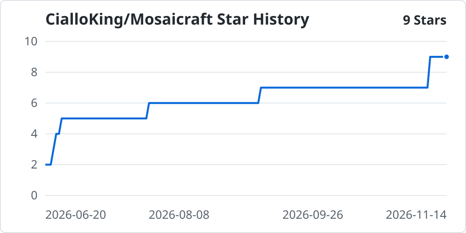

# Mosaicraft

Mosaicraft 用图库里的照片拼出一张目标图，可通过本地 Web UI 或命令行运行。生成前可以实时预览并逐格换图，生成时可用 NVIDIA CUDA 加速，并将超大图流式写入文件。

[下载最新版](https://github.com/CialloKing/Mosaicraft/releases/latest) · [快速开始](#快速开始) · [使用指南](#使用指南) · [CUDA 模板](#cuda-分辨率模板) · [源码构建](#安装与构建) · [Star 历史](#star-历史)

（本项目纯AI生成，绝无手写代码）

## 下载与运行

在 [GitHub Releases](https://github.com/CialloKing/Mosaicraft/releases/latest) 的 **Assets** 中，按平台和文件名后缀选择发布包。使用支持 CUDA 13.5 的 NVIDIA 驱动时可选 CUDA 包，其余情况选 CPU 包。

| 平台 | 系统基线 | CPU 包后缀 | CUDA 包后缀 |
| --- | --- | --- | --- |
| Windows x64 | Windows 10 22H2 | `_windows-x64_cpu-only.zip` | `_windows-x64_cuda.zip` |
| Linux x64 | Ubuntu 22.04 / glibc 2.35 | `_linux-x64_cpu-only.tar.gz` | `_linux-x64_cuda.tar.gz` |
| macOS ARM64 | macOS 13 | `_macos-arm64_cpu-only.tar.gz` | — |

包内 `BUILD_INFO.txt` 记录构建配置和 GPU 验收状态。v1.15.4 按维护者要求跳过全部测试，Windows/Linux CUDA 包均为 `GpuValidation: not-run`，未做 GPU 实机验收。 [v1.15.4 发布说明与校验值](https://github.com/CialloKing/Mosaicraft/releases/tag/v1.15.4)

## 快速开始

准备一张**目标图**和一个**素材目录**。建库后，Mosaicraft 会从图库中挑选素材，逐格拼出目标图。

### Web UI

解压后，Windows 双击 `MosaicraftWebUI.exe`，Linux/macOS 在解压目录运行 `./MosaicraftWebUI`。浏览器默认打开 [http://localhost:8080](http://localhost:8080)。

1. **建库。** 在「建库」页填写素材目录和图库输出目录，点击「运行」。完成后点击「使用此图库」，将数据库路径填入生成表单。
2. **设置输出。** 在「生成马赛克」页填写目标图和输出路径。用「输出规划」查看尺寸、内存和文件体积估算，展开「目标与图库覆盖」检查亮度候选不足的区域。初次试跑可将「输出 Tile 尺寸」设为 `18x32`。
3. **预览与选图（可选）。** 在「预览」页查看目标参考图、素材复用和匹配误差，或手动替换单格素材。可保存 A/B 快照比较参数。保持当前预览开启并完成匹配，正式生成会沿用选图结果。
4. **生成。** 点击「运行」，在「任务与结果」查看文件、阶段耗时和历史摘要。生成前勾选「质量分析」可查看误差直方图和热力图，勾选「资源监控」可查看进程 CPU、内存及可用的 CUDA 指标。

相对路径以页面顶部显示的服务工作目录为准。更多参数和示例见「使用帮助」。

### 命令行

在解压目录运行以下命令。`photos` 是素材目录，`target.jpg` 是目标图。示例生成 `result.png` 和便于查看的 `result_preview.jpg`。Windows PowerShell 也可运行 `./mosaicraft.exe`。

```powershell
./mosaicraft library build photos -o library --size 180x320 -r
./mosaicraft create target.jpg -l library -o result.png --output-tile 18x32 --thumbnail
```

CLI 已重新组织，不保留旧命令别名。每个命令支持 `--help`，全部选项用 `--help-all`。
`--json` 使 stdout 只输出一个 JSON 结果，进度和诊断写入 stderr；`--quiet` 隐藏普通进度，保留结果和错误。

## 使用指南

### 建库与图库管理

```powershell
./mosaicraft library build photos -o library/270x480 --size 270x480 -r
./mosaicraft library add new_photos -l library/270x480 -r
./mosaicraft library report library/270x480 --check
./mosaicraft library report library/270x480 --deep
./mosaicraft library usage library/270x480 --sort tiles --limit 0 --unused
./mosaicraft library export library/270x480 -o used_photos --selection used
./mosaicraft library purge library/270x480
./mosaicraft library purge library/270x480 --apply
./mosaicraft library normalize photos -o normalized --size 180x320
```

建库归一化尺寸默认 180×320，每轴 1～8192；同尺寸素材保留原文件字节。`build` 只创建新图库，`add` 继承已有规格，保持素材 ID 和统计，并沿用颜色排序。改变规格请新建目录。`normalize` 只复制和归一化，不创建数据库，输入输出目录不得重叠。

`report` 默认快速统计，`--check` 检查资源和特征，`--deep` 再解码并核对像素摘要。LAB 亮度使用 OpenCV 8 位口径，分段为 50/150。覆盖不足和使用不均属于提示；缺失、不可读和损坏属于完整性失败。`purge --apply` 仅删除确认缺失的记录，权限错误和未使用状态不属于自动清理依据。

成功 `create` 自动记录最终排列的使用情况，无需 `--analyze`。`usage --sort targets` 按已记录独立目标数排名，`--sort tiles` 按累计格数；“未使用”表示未出现在已记录历史中。浏览、检查、打包和工程回导不会增加图库统计。

### 尺寸与输出

| 参数 | 行为 |
| --- | --- |
| `--match-tile WxH` | 目标每格覆盖像素，默认 9×16。 |
| `--output-tile WxH` | 输出每格像素，默认 180×320；横向图库默认取 320×180。放大仅重采样包内素材。 |
| `--target-size WxH` | 匹配前调整目标尺寸；允许单轴 `auto`，双轴指定可改变比例。 |
| `--target-upscale N` | 调整目标尺寸后再放大，随后按既有规则补边。 |
| `--mode image\|html\|deepzoom\|tiles` | 决定单图或完整目录结构。已知图片后缀可推导 image，其他路径必须指定模式。 |
| `--format jpg\|png\|webp\|tiff` | 图片编码；HTML 与编码参数互斥，Deep Zoom/分块固定使用 JPEG。 |
| `--target-blend 0..1` | 目标叠加，默认 0。 |
| `--brightness-jitter 0..0.5` | LAB 亮度扰动，默认 0；HTML 必须为 0。 |
| `--seed N` | 无符号 32 位种子；未指定时生成并记录。 |
| `--backend auto\|cpu\|cuda` | 建库和匹配后端；auto 可回退并报告原因，显式 cuda 不可用时失败。 |
| `--threads N` | CPU 工作上限，0 自动，各阶段可进一步收缩。 |

```powershell
./mosaicraft create target.jpg -l library -o result.png --write-mode stream --thumbnail
./mosaicraft create target.jpg -l library -o blended.png --target-blend 0.2 --analyze
./mosaicraft create target.jpg -l library -o zoom-view --mode deepzoom
./mosaicraft create target.jpg -l library -o tiles --mode tiles
```

单图 `--format` 优先于后缀；JPG/WebP 超限时继续使用既有策略：推导格式转等尺寸 PNG，显式格式缩小输出图块。JPEG/WebP `--quality` 默认 100，PNG `--png-compression` 默认 1、范围 1～9。`--overwrite` 允许替换已有文件；目录只允许覆盖可识别且没有额外文件的 Mosaicraft 输出。工程与 ZIP 先暂存后发布，失败保留旧输出。

匹配策略与默认权重保持不变。`--random-top` 默认 10、`--reuse-penalty` 默认 0.01；`--candidates`、`--l-range`、邻域与权重参数仍可用。`inspect <target> -l library` 分别提供整图特征和按正式预处理计算的网格覆盖。

### HTML 便携工程与回导

```powershell
./mosaicraft create target.jpg -l library -o artwork --mode html --target-blend 0.2
./mosaicraft project info artwork
./mosaicraft project check artwork --deep
./mosaicraft render artwork -o result.tiff --output-tile 360x640
./mosaicraft render artwork/project.json -o result.png --target-blend 0.2 --brightness-jitter 0.04
./mosaicraft project pack artwork -o artwork.zip
```

HTML 输出是完整目录：`project.json`、`index.html`、无损 `target.png` 和 `assets/<素材索引>/<原图库图片文件名>`。每份唯一素材只复制一次，保留原文件名与字节，不生成 overview、缩略图或兼容显示副本。查看器直接加载视口素材，不设应用图片缓存上限，加载并发为 8；全景可能加载全部用到的素材，内存随素材增长。复制整个目录即可移动；传输时用 `project pack` 生成完整 ZIP64，解压后离线打开 `index.html`。浏览器支持缩放、平移、全屏、目标参考和素材查看，不提供编辑或原生图片导出。新导出为工程格式 2，继续支持格式 1 检查和回导。

`render` 接受工程目录、其中的 `project.json` 或 `index.html`，不直接读取 ZIP。排列固定，不重新匹配、不打开原图库、不执行 CUDA 预检。可调整输出模式、编码、图块尺寸、叠加、亮度和外观种子；省略尺寸、外观和种子时继承工程。相同工程、参数及环境下重复输出具有相同解码像素；`render --seed` 只改变外观随机性。输出到新的 HTML 目录可以保存新的叠加效果。

Web UI 的「便携工程」页支持信息、检查、回导与打包，全部复用现有任务队列。HTML 下载需先打包；单独下载入口文件会被拒绝。Deep Zoom 继续保留。

详见 [工程格式与命令迁移](docs/CLI_PROJECTS.md)、[HTTP API](docs/API.md)、[本次验收记录](docs/CLI_PROJECTS_VERIFICATION.md)。

## CUDA 分辨率模板

CUDA 可用时，建库、实时预览和生成会根据图库的归一化尺寸自动选择模板，用于特征提取和候选评分。其他合法尺寸可走与 CPU 兼容的通用 CUDA 路径。

| 方向 | v1.15.2 发布包 | v1.15.4 发布包 |
| --- | --- | --- |
| 正方形 | — | 256×256、512×512 |
| 竖屏 9:16 | 180×320、360×640 | 180×320、270×480、360×640、540×960 |
| 横屏 16:9 | 320×180、640×360 | 320×180、480×270、640×360、960×540 |

预检发现 CUDA 不可用时，任务使用 CPU 并记录原因。 [CUDA 架构与验收](docs/CUDA_ARCHITECTURES.md)

## 安装与构建

### Linux 与 macOS

源码构建使用 C++17 编译器、CMake 3.21+、Ninja，以及系统提供的 OpenCV 4、SQLite、TIFF、PNG 和 JPEG 开发库。Ubuntu 22.04 自带的软件源满足 CMake 版本要求。macOS 请先安装 Xcode Command Line Tools（`xcode-select --install`）和 Homebrew。

```sh
git clone https://github.com/CialloKing/Mosaicraft.git
cd Mosaicraft
./scripts/build-native.sh --install-deps
```

`--install-deps` 在 Debian/Ubuntu 上调用 apt，在 Fedora 上调用 dnf，在 macOS 上调用 Homebrew。开发库已安装时，直接运行 `./scripts/build-native.sh`。也可手动执行 `cmake --preset linux-cpu` 和 `cmake --build --preset linux-cpu`，macOS 使用 `macos-cpu`。自定义依赖位置可通过 `CMAKE_PREFIX_PATH` 提供。

- Linux CPU 产物在 `build/linux-cpu/Release/bin`，macOS 在 `build/macos-cpu/Release/bin`。进入目录后运行 `./MosaicraftWebUI` 或 `./mosaicraft --help`。
- Linux CUDA 构建先安装 CUDA Toolkit 13.5.0（nvcc 13.5.37），再运行 `CUDAToolkit_ROOT=/usr/local/cuda-13.5 ./scripts/build-native.sh --cuda`。将路径换成实际安装位置。产物在 `build/linux-cuda/Release/bin`。 [CUDA 工具链](docs/CUDA_13_5_MIGRATION.md)
- 原有 vcpkg 构建缓存可用新的构建目录避开，例如 `cmake --preset linux-cpu -B build/linux-system`，然后运行 `cmake --build build/linux-system`。

### Windows

使用 Visual Studio 2026 的 C++ 工具、CMake 4.2+、PowerShell 7 和 Git。已有对应提交的 vcpkg 时，设置 `VCPKG_ROOT` 后即可依次运行 `Prepare` 和 `Install`。

```powershell
git clone https://github.com/CialloKing/Mosaicraft.git
cd Mosaicraft
git clone https://github.com/microsoft/vcpkg.git build/tools/vcpkg
git -C build/tools/vcpkg checkout a0400024711b283056538ac19ced80b91a83c24c
$env:VCPKG_ROOT = (Resolve-Path build/tools/vcpkg).Path
./scripts/setup-dependencies.ps1 -Mode Prepare
./scripts/setup-dependencies.ps1 -Mode Install
```

使用 CUDA 时将下方的 `windows-cpu` 换成 `windows-cuda`，并设置 `$env:CUDAToolkit_ROOT = 'C:/Program Files/NVIDIA GPU Computing Toolkit/CUDA/v13.5'`。 [架构与单卡构建](docs/CUDA_ARCHITECTURES.md)

```powershell
$preset = 'windows-cpu'
cmake --preset $preset
cmake --build --preset $preset --target mosaicraft MosaicraftWebUI --parallel
```

构建产物位于 `build/<preset>/Release/bin`。

发布包使用独立的固定依赖和验收流程，推送 `v*` 版本标签会触发打包。 [发布清单](docs/RELEASE_CHECKLIST.md)

## 开发文档

- 接口文档列出请求字段、异步任务和诊断信息。运行 Web UI 后可通过 `GET /api/info` 查看版本和能力。 [REST API](docs/API.md)
- 匹配流程使用 AvgLAB、8×8 Grid、TinyImage、边缘密度和 LBP，结合候选召回、评分与邻域去重。 [项目百科](docs/ENCYCLOPEDIA.md)
- 固定样本的预览耗时、流式 PNG 导出和 CPU 建库结果。 [v1.15.2 预览性能对照](docs/PREVIEW_VERIFICATION.md#v1152-预览性能对照)
- 原生包构建、GPU 验收和 SHA256 校验流程。 [CI 与打包](docs/CI_PACKAGING.md) · [发布清单](docs/RELEASE_CHECKLIST.md)

## Star 历史

<p align="center">
  <a href="https://github.com/CialloKing/Mosaicraft/blob/star-history/stars.csv">
    
  </a>
</p>

GitHub Actions 每天北京时间 03:17 记录 Star 数量。首批历史按采集时仍有效的 Star 时间重建，后续以每日实测为准。 [查看 CSV 原始数据](https://github.com/CialloKing/Mosaicraft/blob/star-history/stars.csv)

## 许可证

本项目采用 GNU 通用公共许可证第 3 版（`GPL-3.0-only`）。 [许可证全文](LICENSE)
