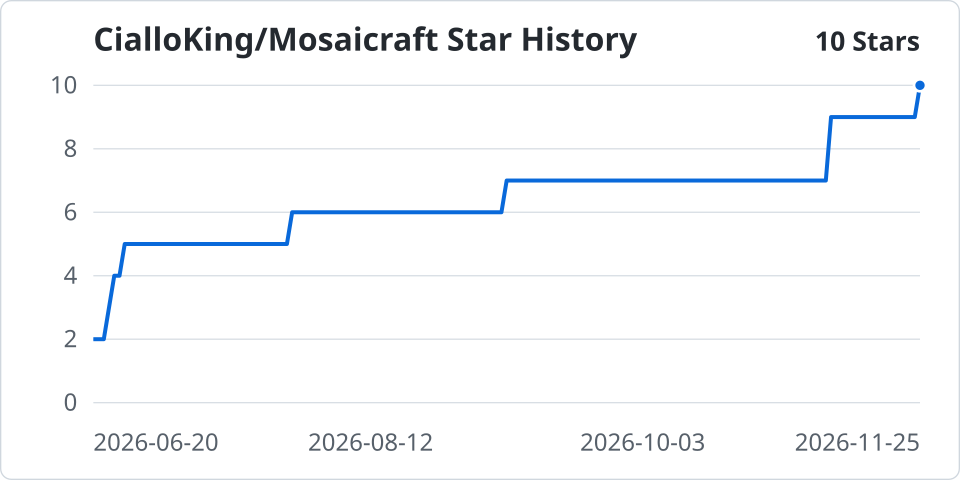

# Mosaicraft

Mosaicraft 用图库里的照片拼出一张目标图，提供 Qt 桌面应用、本地 Web UI 和命令行，支持交互预览、逐格换图、超大图流式输出与离线 HTML 工程。

（本项目纯AI生成，绝无手写代码）

[下载稳定版](https://github.com/CialloKing/Mosaicraft/releases/latest) · [快速开始](docs/guides/quick-start.md) · [文档中心](docs/README.md) · [源码构建](docs/development/building.md)

## 下载与运行

在 GitHub Releases 的 **Assets** 中按平台选包。智能裁剪包提供 CLI 和 Web UI，Qt 包提供桌面客户端。v1.15.19 的文件名后缀见下表。[下载稳定版](https://github.com/CialloKing/Mosaicraft/releases/latest) · [版本历史](docs/releases.md)

| 平台 | 智能裁剪包 | Qt 客户端包 |
| --- | --- | --- |
| Windows x64 | `_windows-x64_cuda-vulkan-smart-crop.zip` | `_windows-x64_qt_cuda-vulkan.zip` |
| Linux x64 | `_linux-x64_cuda-vulkan-smart-crop.tar.gz` | `_linux-x64_qt_cuda-vulkan.tar.gz` |
| macOS ARM64 | `_macos-arm64_cpu-only-smart-crop.tar.gz` | `_macos-arm64_qt.tar.gz` |

Windows 和 Linux 的智能裁剪包内置真人与动漫模型，支持 CPU、CUDA 和 Vulkan 推理。Vulkan 推理用于「仅归一化」。macOS 智能裁剪使用 CPU。桌面版解压后启动 `MosaicraftDesktop`（macOS 打开 `.app`）。[智能裁剪用法](docs/development/smart-crop.md) · [桌面包说明](docs/development/packaging.md#qt-桌面发布包)

## 快速开始

使用 Web UI 时，Windows 启动 `MosaicraftWebUI.exe`，Linux/macOS 在解压目录运行 `./MosaicraftWebUI`。浏览器打开 [http://localhost:8080](http://localhost:8080)。

1. 在「建库」页导入素材，建立新图库。
2. 在「生成马赛克」页选择目标图、图库和输出路径。
3. 先用预览检查选图，再运行生成；任务详情显示实际后端与耗时。

命令行可在解压目录运行：

```sh
./mosaicraft library build photos -o library --size 180x320 -r
./mosaicraft create target.jpg -l library -o result.png --output-tile 18x32 --thumbnail
```

Windows PowerShell 使用 ./mosaicraft.exe。完整步骤见[快速开始](docs/guides/quick-start.md)。

## 文档导航

| 需要做什么 | 文档 |
| --- | --- |
| 操作界面、预览、复制多种 Shell 命令 | [Web UI 指南](docs/guides/web-ui.md) |
| 管理图库、调整尺寸、选择输出格式 | [命令行指南](docs/guides/cli.md) |
| 选择显卡、后端与精度模式 | [GPU 后端](docs/guides/gpu-backends.md) |
| 复制图库、离线浏览或回导工程 | [搬移图库](docs/guides/portable-libraries.md) · [便携工程](docs/guides/portable-projects.md) |
| 接入服务、构建、测试与打包 | [HTTP API](docs/reference/api.md) · [开发文档](docs/README.md#接口与开发) |
| 查找旧版验收、性能样本与研究 | [历史档案](docs/archive/README.md) · [原始数据](docs/performance/README.md) |

## Star 历史

<p align="center">
  <a href="https://github.com/CialloKing/Mosaicraft/blob/star-history/stars.csv">
    
  </a>
</p>

GitHub Actions 每天北京时间 03:17 记录 Star 数量。首批历史按采集时仍有效的 Star 时间重建，后续以每日实测为准。 [查看 CSV 原始数据](https://github.com/CialloKing/Mosaicraft/blob/star-history/stars.csv)

## 许可证

本项目采用 GNU 通用公共许可证第 3 版（GPL-3.0-only）。[许可证全文](LICENSE)
