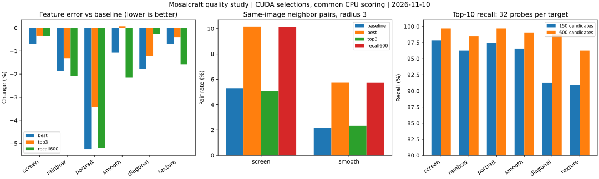

# Mosaicraft 可复现画质对照实验

日期：2026-11-10。生产代码基线：v1.14.11；本次只增加显式基准工具与研究产物，没有修改 `core/`、`compute/`、`src/`、默认参数、特征 v6 或生产 API。

## 结论

当前应优先研究**质量阈值内随机 + 二维重复约束 + 候选稀缺诊断**，然后验证受限目标调色。现有证据不足以支持直接把默认 Top-10 改成 Top-1，或把候选数统一提高到 600。

- 人物样本中，Top-1 的基础特征误差比默认低约 5.25%，灰度 SSIM 从 0.2057 升至 0.2295；这是本次样本的指标变化，不是“画质提高 5.25%”。
- 平滑明暗图中，Top-1 的基础误差只下降约 1.08%，半径 3 内同图重复对比例却从 2.17% 升至 5.74%。屏幕测试图对应比例从 5.27% 升至 10.17%。
- 抽样 Top-10 召回从 150 候选的 95.05% 升到 600 候选的 98.65%，但相对 150 候选 Top-1，600 候选的端到端画质收益很小且不一致。
- 屏幕测试图有 7/32 个抽样位置在亮度范围内最多只有 10 张素材，其中一个位置仅有 2 张。扩大 ANN 候选数不能突破这个亮度过滤后的图库上限。

这些结论适用于当前图库、六类目标和固定密度。只包含一个实际人物目标，不能推广为所有人物、风景或其他图库的结论。

## 方法与可复现性

使用原 45,625 张、180×320 图库的 SQLite backup 私有快照。每次生成恢复相同数据库和历史使用统计；独立特征通过硬链接或复制放入私有目录，ANN/FeaturePack 也在该目录准备，原素材仅用于读取。

原数据库 SHA-256：

```text
3571d04f2d9b51411fce39a41a132dee093eb75586745a24a2ca4fe180ed7e5a
```

六类目标为：两张现有屏幕测试图、`target5.png`，以及程序生成的平滑明暗、斜线轮廓和细密纹理图。按原比例缩放至长边 640，匹配块为 9×16，沿用现有镜像补边；输出小图 45×80、PNG stream。关闭随机亮度、主图叠加和自适应权重。

| 方案 | candidates | topNrandom |
| --- | ---: | ---: |
| baseline | 150 | 10 |
| best | 150 | 1 |
| top3 | 150 | 3 |
| recall600 | 600 | 1 |

每个目标运行三个固定种子：42、20261110、20261111。CPU 与模板 CUDA **各 72 次**，共 144 次主实验。另有 12 次重复性检查、32 次性能运行；性能中 8 次为预热，24 次纳入统计。

本机为 RTX 4060 Laptop GPU 8 GiB、CUDA 13.5.37、MSVC 19.51，C++ OpenCV 4.12.0，Python OpenCV 5.0.0。CUDA 基准只编译本机 sm_89。输入、配置、代码提交、二进制和文件摘要保存在 [完整数值数据](performance/quality-study-20261110.json)。

### 指标定义

- **基础特征误差**：在公共 CPU 参考空间重新提取目标特征，复用现有 `cpuBaseScore`；保留五特征默认权重，去掉历史和邻域惩罚，报告均值、P90、P99。
- **画面误差**：实际输出 PNG 缩回补边后的目标工作尺寸，计算 OpenCV 编码 LAB 三通道 MAE；它不是 CIEDE2000。
- **灰度 SSIM**：11×11、sigma=1.5 的局部高斯窗口，使用 8 位灰度常量，排除 5 像素外边界。
- **同图重复率**：在归一化网格坐标中使用 `dx²+dy² <= r²`，r=1、2、3；每对只计一次，分母是两个位置均匹配成功的邻近对。
- **相似素材重复率**：另外统计不同素材之间现有 8×8 Grid 距离小于 0.010 的邻近对；这是特征相似，不是人物或语义相似识别。
- **召回诊断**：每个目标沿位置序号均匀抽取 32 块，穷举全库五特征基础分数；分别记录亮度过滤损失、过滤后 Top-10 的 ANN 召回和 ANN 最佳误差损失。

召回的并列分数按“分数、图库下标”排序。等分素材替代可能降低 ID 召回而没有质量损失，因此同时报告最佳误差损失。

## 实际结果

下表均为三个种子的均值。变化率针对当前场景的 baseline；负数表示基础误差下降。半径 3 重复率用百分比表示。

### 模板 CUDA 选图，公共 CPU 评价

| 目标 | baseline 误差 | best 变化 | top3 变化 | recall600 变化 | baseline / best 的重复率 |
| --- | ---: | ---: | ---: | ---: | ---: |
| 屏幕测试 | 0.3709 | -0.70% | -0.35% | -0.36% | 5.27% / 10.17% |
| 彩虹渐变 | 0.5470 | -1.86% | -1.31% | -2.09% | 0.00% / 0.00% |
| 人物 | 0.1723 | -5.25% | -3.41% | -5.19% | 0.02% / 0.01% |
| 平滑明暗 | 0.1781 | -1.08% | +0.07% | -2.15% | 2.17% / 5.74% |
| 斜线轮廓 | 0.1435 | -1.77% | -1.23% | -0.28% | 0.06% / 0.04% |
| 细密纹理 | 0.3798 | -0.68% | -0.40% | -1.57% | 0.00% / 0.00% |

### CPU 选图，公共 CPU 评价

| 目标 | baseline 误差 | best 变化 | top3 变化 | recall600 变化 | baseline / best 的重复率 |
| --- | ---: | ---: | ---: | ---: | ---: |
| 屏幕测试 | 0.3706 | -0.66% | -0.24% | -0.27% | 5.22% / 10.21% |
| 彩虹渐变 | 0.5466 | -1.87% | -1.21% | -2.11% | 0.00% / 0.00% |
| 人物 | 0.1723 | -5.35% | -3.37% | -5.21% | 0.02% / 0.01% |
| 平滑明暗 | 0.1783 | -1.00% | +0.10% | -2.02% | 2.20% / 5.74% |
| 斜线轮廓 | 0.1431 | -1.98% | -1.45% | -1.16% | 0.05% / 0.04% |
| 细密纹理 | 0.3798 | -0.69% | -0.40% | -1.60% | 0.00% / 0.00% |

对六个场景等权计算，best 的误差平均变化为 CPU -1.93%、CUDA -1.89%；top3 为 -1.09% / -1.10%；recall600 为 -2.06% / -1.94%。不同场景原始分数不可当成相同的感知质量尺度，因此这只是等权相对变化摘要。

Top-1 并非稳定的整体最优。例如 CUDA 人物场景的 SSIM 改善，但彩虹场景从 0.0867 降到 0.0851。recall600 的斜线场景基础误差略降，SSIM 却从 0.2656 降至 0.2322。不能只用特征误差挑选默认方案。

全图独立素材数量也不能代替空间重复指标：CUDA 屏幕场景 best 的独立素材从约 990 增到 1012，但半径 3 的同图重复率接近翻倍。



### 召回与亮度过滤

| 目标 | Top-10 召回：150 / 600 | 亮度范围内最少素材数 | 32 块中亮度过滤的最大基础误差损失 |
| --- | ---: | ---: | ---: |
| 屏幕测试 | 97.81% / 99.69% | 2 | 0.09804 |
| 彩虹渐变 | 96.25% / 98.44% | 1297 | 0.09115 |
| 人物 | 97.50% / 99.69% | 57 | 0 |
| 平滑明暗 | 96.56% / 99.06% | 3 | 0 |
| 斜线轮廓 | 91.25% / 98.75% | 11 | 0.00984 |
| 细密纹理 | 90.94% / 96.25% | 10887 | 0 |

192 个抽样位置中，人物、平滑明暗、纹理在 150 候选下已经召回了过滤范围内的最佳基础分数。其他场景的平均 ANN 最佳误差损失不超过 0.000377；其中个别位置的亮度过滤损失明显更大。

600 候选相对 150 候选 Top-1 的主实验墙钟中位数，按场景等权相对变化约为 CPU +39.0%、CUDA +19.8%。这来自主实验运行记录，不是单独设计的 600 候选性能基准。召回增加不能解释成最终画质必然增加：选图改变后，后续邻域状态也会改变。

### 性能采样

每组预热一次，正式测三次；表中是墙钟中位数。采样程序的开销包含在墙钟内。

| 目标 / 后端 | baseline | best |
| --- | ---: | ---: |
| 人物 / CPU | 2.830 s | 2.819 s |
| 人物 / CUDA | 2.704 s | 2.690 s |
| 彩虹 / CPU | 2.471 s | 2.471 s |
| 彩虹 / CUDA | 2.537 s | 2.523 s |

两方案的差异约 0～0.6%，没有足够证据解释为稳定加速。进程 PeakWorkingSet 的中位数约为 CPU 216～217 MiB、CUDA 309～311 MiB；完整逐组值见 JSON。GPU 记录是采样时的**整张设备占用**，包含其他应用，不能当成该进程的独占显存峰值。

## 验证与交付边界

- 核心测试、回归测试通过；四个非法种子/未知参数检查通过。
- 12/12 次同后端重复检查的选图和解码像素完全一致；不要求 CPU 与模板 CUDA 彼此相同。
- 全部主实验完整出图，缺失图块为 0，后端符合请求，没有把 CUDA 回退误记成 CUDA。
- 独立 NumPy/OpenCV 重算屏幕场景全部 1656 块，平均分与 C++ 相差约 `1.36e-11`；半径 1 的 3217 对、187 个同图对完全一致。
- 原数据库前后 SHA-256 相同；全部原素材及独立特征文件的路径、尺寸、修改时间聚合摘要相同。没有声称逐文件进行了前后内容哈希。
- 选图下标按 `Database::allRecords` 解释，不能直接当成图片 ID。省略其亮度 WHERE 条件可能改变等使用次数记录的顺序；附件提供固定的下标到 ID 映射。

素材局部中出现了不能展示的露骨未成年形象内容，因此交付的匿名图采用**存储均色与素材编号**，不包含素材近景，也不附带原始马赛克图像。总览中的 A～D 不是实际输出像素图；数值 LAB/SSIM 指标仍来自先前生成的实际 PNG。局部中心和两个高误差位置由 CPU baseline、种子 42 固定，所有方案使用相同坐标。**近看素材的主观保真评价本轮没有完整完成，不据此作视觉结论。**

## 下一轮建议

后续已完成[选图策略实现与对照](SELECTION_STUDY.md)：固定质量门槛会显著增加重复，二维去重也有全局多样性代价，尚未选出可推广方案。下列建议保留为第一轮结束时的研究顺序。

1. **质量阈值内随机**：保留多样性，先排除基础误差明显落后的候选。Top-3 的结果可作为折中参考，但不足以直接设为新默认。
2. **二维重复约束与可解释降级**：优先解决实际相邻重复；当亮度范围内只有 2～3 张素材时，严格禁止重复可能无法填满，必须同时处理候选稀缺。
3. **稀缺诊断与受限目标调色实验**：按有效候选数量定位问题，比较适度放宽亮度范围、补充缺失色调素材、目标驱动调色的取舍。
4. **按需扩搜与位置分配后置验证**：当前抽样不支持全局加大候选数；先在困难位置触发扩搜。候选分差优先分配应在二维约束与稀缺处理明确后再实验。

## 复现

需要 Python 的 NumPy、Pillow、OpenCV、Matplotlib；C++ 使用仓库已有依赖。生产 CLI/API 未增加研究专用参数。

```powershell
cmake -S . -B build/quality-20261110 `
  -DCMAKE_TOOLCHAIN_FILE=D:/C++project/SDK/vcpkg/scripts/buildsystems/vcpkg.cmake `
  '-DCUDAToolkit_ROOT=C:/Program Files/NVIDIA GPU Computing Toolkit/CUDA/v13.5' `
  -DCUDA_ARCH=sm_89
cmake --build build/quality-20261110 --config Release `
  --target mosaicraft_match_benchmark mosaicraft_quality_benchmark --parallel 4
python scripts/quality_study.py `
  --match build/quality-20261110/Release/bin/mosaicraft_match_benchmark.exe `
  --quality build/quality-20261110/Release/bin/mosaicraft_quality_benchmark.exe `
  --output-dir build/quality-study-recheck
```

也可使用 `--phase prepare|runs|evaluate` 分阶段运行。成功的运行会保存检查点；二进制变化或旧运行摘要不匹配时需使用新的输出目录。默认输入目录为 `test_input_photos`，默认图库为 `library/180x320/mosaicraft.db`。

工具源码为 [画质实验调度](../scripts/quality_study.py)、[固定种子生成入口](../scripts/benchmark_match.cpp)、[公共 CPU 评价与全库诊断](../scripts/benchmark_quality.cpp)。本次完整工作目录位于忽略目录 `build/quality-study-20261110`；可交付数值数据已归档到本文链接的 JSON，匿名编号/均色图和选图记录另打包为本地证据附件。
