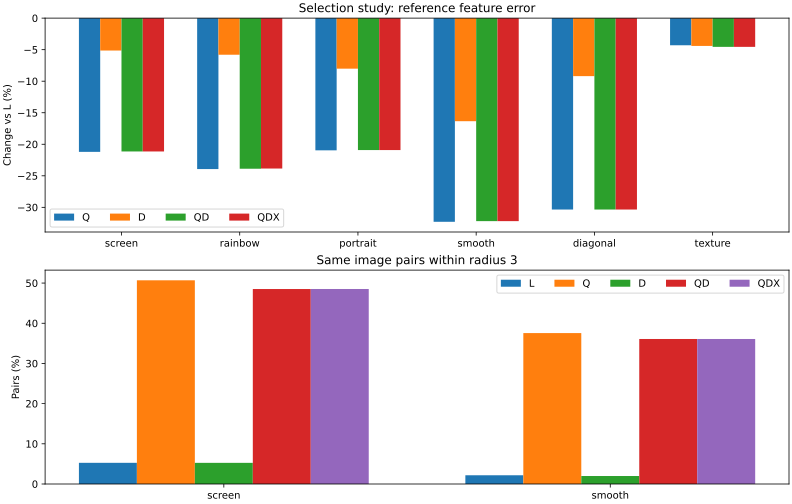

# Mosaicraft 选图策略实验

> 历史归档：本文保留当时的命令、版本与测量结果，不作为当前操作指南。当前用法请从[文档中心](../../README.md)进入。


日期：2026-11-10。基于已完成的[第一轮画质对照](quality-study.md)，仅研究选图阶段。生产配置、默认选图、特征 v6 和图库格式保持不变；策略只通过 `MatchingAccess` 和显式基准程序启用。

## 结论

**本轮没有选出兼顾还原、空间重复和全局素材多样性的方案，全部保留为基准实验。** D 只替换二维去重、不加全局质量门槛，基础特征误差相对 L 的六场景等权平均下降 CPU 8.35%、CUDA 8.15%，原库六类目标的半径 3 同图重复均值均未升高；但独立素材数显著减少，远处同图复用增加。这不等于最终视觉画质提高 8%。

固定 5% 质量门槛显著降低特征误差，同时把多个目标的选图压缩到极少数素材。Q/QD/QDX 在屏幕、渐变、斜线等场景出现大量重复。增加二维约束后，质量池仍不足，按既定规则只能降半径。2%/10% 敏感性实验也未找到对全部目标均合适的固定门槛。

QDX 在五类目标的 82%～100% 位置触发扩搜，其中超过 99.6% 扩搜位置最终仍不足三张满足“质量边界＋半径 3”的候选。相对 QD 没有稳定收益，匹配耗时却明显增加，因此当前触发器保留为实验。

下一轮可从 D 出发，先研究二维约束与全局多样性的平衡、稀缺区域的距离降级，再验证小范围修补。Regret、近似图分组及产品接入继续后置。D 的正式三次性能采样和真实照片的近看评价仍需补充。

## 实现与取舍

共用选择器分开保存纯特征误差 E、历史使用代价 H 和邻域规则。CPU 和模板 CUDA 都先以 `usePenalty=0` 得到 E，再在阈值池中计算 E+H；Q 另外使用原有邻域代价。新策略的等分候选按稳定素材 ID 排序，最终在最多十张中用固定种子均匀随机。

| 组别 | 质量池 | 邻域 | 召回 |
| --- | --- | --- | --- |
| L | 原 Top-10 | 原扫描惩罚 | 150 |
| Q | E ≤ Emin+0.0001+5%×Emin | 原扫描惩罚 | 150 |
| D | 不设误差阈值，取前 10 | 二维距离 | 150 |
| QD | 同 Q | 二维距离 | 150 |
| QDX | 同 Q，扩搜后重算 | 二维距离 | 按需 150→300→600 |

二维策略整体替换频率窗口、固定间隔和相似图窗口三个惩罚。按 `dx²+dy²≤r²` 检查已选位置，先尝试同图半径 3，无法选择时依次降到 2、1、0。在该层候选中优先排除半径 1 内的不同 ID 相似图，Grid 阈值沿用 0.010；没有替代时接受并记录。没有新增全局使用配额。

QDX 在半径 3 内合格候选少于三张时扩搜。各次 ANN 结果按素材 ID 合并，只评分新增且通过亮度过滤的素材；重新计算 Emin 和质量池。由于 HNSW 结果未必严格嵌套，合并池最多可能有 150+300+600 张，不把“查询 K=600”误称为“累计候选最多 600”。达到三张后停止；否则查到 600 再降距离。亮度范围和质量阈值都不放宽。

HNSW 当前实现使用 `max(ef,k)` 作为搜索宽度，所以增加 K 同时改变返回数量和搜索工作量，本轮未单独调 ef。实验扩搜支持 CPU、模板 CUDA；不通过混用 CPU 分数掩盖其他后端的限制。

候选与双精度分数只保留当前图块，二维约束复用已有选择网格。候选缓存、相似性缓存、诊断数组和扩搜暂存计入可控主机缓冲预算；该预算不等于整个进程 RSS。QDX 的 CUDA 扩搜复用当前设备特征，因此关闭下一批预取，避免当前工作区被覆盖，这部分代价包含在性能结果中。

## 实验与检查方法

- 原图库沿用 45,625 张快照、六类目标、三个种子和第一轮的尺寸设置；每次恢复相同历史使用统计。ANN 和特征缓存位于本轮独立目录。
- 原图库一律使用 `--match-only`：不加载素材像素，不贴图、不编码、不提交使用次数。每次运行检查数据库字节摘要不变；全过程另核对原数据库摘要和全部原素材/特征的路径、尺寸、修改时间摘要。
- 主实验 180 次；2%/10% 阈值敏感性共 12 次。原库的均值/P90/P99、独立素材数和二维重复率由公共 CPU 参考特征重新计算，不能直接解释为最终视觉画质。
- L 的 36 组选图摘要逐一对照第一轮存档。Q、D、QD、QDX 在六类目标、两种后端上分别复跑一次，并将最大批次改为 17 再跑一次，共 96 次确定性检查。
- 性能只对 L/QDX、人物/平滑明暗、CPU/CUDA 做每组一次预热和三次正式采样，共 32 次。报告匹配阶段时间中位数、进程 PeakWorkingSet 采样峰值和整张设备显存采样。匹配阶段包含索引加载、评分资源准备、特征、检索及选图；不包含素材读取和编码，不能与第一轮完整出图墙钟直接相比。
- 合成图库由种子 20261110 程序生成 1,037 张图案。四类目标覆盖候选充足、亮度过滤后恰好两张/三张候选、相似图与跨行重复。五组、两个后端共 40 次完整出图，另做 8 次 QDX 跨批次选图和像素复验。
- 合成输出补充 LAB MAE、灰度 SSIM、匿名全图和固定裁剪。裁剪由 CPU L 的中心及两个最高误差位置确定，所有组和后端共用坐标；这类图案只能验证程序行为，不代表真实照片图库的近看素材质量。

必要测试覆盖零误差、等分、单候选、空候选、跨行邻居、稀缺降级、扩搜 ID 去重、重新计算质量边界及批次边界。仅匹配回归使用不存在的素材路径证明不读取照片，并检查使用统计不变。

## 实测结果

以下主实验数值为三个种子的均值，变化率相对相同后端的 L。完整逐次结果、P90/P99、全部半径统计和选图 ID 映射见[完整 JSON](../../performance/selection-study-20261110.json)。

### CPU：公共 CPU 特征评价

| 目标 | L 误差 | Q 变化 | D 变化 | QD 变化 | QDX 变化 | L / QDX 半径 3 同图比例 |
| --- | ---: | ---: | ---: | ---: | ---: | ---: |
| 屏幕测试 | 0.3706 | -21.13% | -5.08% | -21.08% | -21.08% | 5.22% / 48.68% |
| 彩虹渐变 | 0.5466 | -23.63% | -5.69% | -23.58% | -23.54% | 0.00% / 48.75% |
| 人物 | 0.1723 | -21.20% | -8.14% | -21.18% | -21.18% | 0.02% / 11.89% |
| 平滑明暗 | 0.1783 | -32.33% | -16.42% | -32.27% | -32.27% | 2.20% / 35.62% |
| 斜线轮廓 | 0.1431 | -30.37% | -10.34% | -30.35% | -30.35% | 0.05% / 71.19% |
| 细密纹理 | 0.3798 | -5.08% | -4.43% | -5.01% | -5.01% | 0.00% / 0.03% |

### 模板 CUDA：公共 CPU 特征评价

| 目标 | L 误差 | Q 变化 | D 变化 | QD 变化 | QDX 变化 | L / QDX 半径 3 同图比例 |
| --- | ---: | ---: | ---: | ---: | ---: | ---: |
| 屏幕测试 | 0.3709 | -21.20% | -5.14% | -21.15% | -21.14% | 5.27% / 48.53% |
| 彩虹渐变 | 0.5470 | -23.93% | -5.80% | -23.88% | -23.85% | 0.00% / 54.00% |
| 人物 | 0.1723 | -20.96% | -8.02% | -20.92% | -20.92% | 0.02% / 12.80% |
| 平滑明暗 | 0.1781 | -32.30% | -16.35% | -32.19% | -32.19% | 2.17% / 36.09% |
| 斜线轮廓 | 0.1435 | -30.35% | -9.20% | -30.35% | -30.35% | 0.06% / 71.17% |
| 细密纹理 | 0.3798 | -4.31% | -4.41% | -4.56% | -4.56% | 0.00% / 0.00% |

### 二维去重的收益与代价

D 的直接相邻重复下降较明显，较大半径的改善受稀缺区域限制。屏幕和平滑目标中，D 分别约 18%、9.69% 的位置需要降半径。

D 整体替换三个旧邻域惩罚，本轮不能单独分辨每个旧惩罚的贡献。Q 的质量池也改变了旧邻域策略能够使用的候选范围，其误差下降不能全部归因于随机机制本身。

| 后端 / 目标 | 半径 1：L / D | 半径 3：L / D |
| --- | ---: | ---: |
| CPU / 屏幕测试 | 5.740% / 0.062% | 5.221% / 4.929% |
| CPU / 平滑明暗 | 2.585% / 0.000% | 2.198% / 1.988% |
| CUDA / 屏幕测试 | 5.761% / 0.000% | 5.270% / 5.264% |
| CUDA / 平滑明暗 | 2.618% / 0.000% | 2.174% / 1.988% |

合成的三候选极端场景展示了未胜出的结果：D 虽把半径 1 同图比例从 28.57% 降到 0，半径 3 却从 34.35% 升到 39.78%。当前贪心距离降级并未优化所有半径下的重复总量，不能将“相邻无重复”当成空间重复已解决。

### 全局素材多样性的损失

独立素材数与单图最大选用次数均为三种子的均值。D 缩小了去重的作用范围，保留历史使用代价 H，但没有本次任务的全局动态频率代价，因此大量复用距离超过三个图块的优质素材。

| 目标 | CPU 独立素材：L / D | CUDA 独立素材：L / D | CUDA 单图最大选用：L / D |
| --- | ---: | ---: | ---: |
| 屏幕测试 | 993.7 / 521.7 | 990.0 / 519.7 | 108.0 / 102.7 |
| 彩虹渐变 | 510.7 / 271.7 | 510.3 / 271.7 | 5.0 / 25.0 |
| 人物 | 1133.0 / 792.7 | 1147.3 / 801.0 | 7.0 / 26.7 |
| 平滑明暗 | 1285.0 / 288.7 | 1284.3 / 284.3 | 58.0 / 46.7 |
| 斜线轮廓 | 383.7 / 196.7 | 381.3 / 195.7 | 10.0 / 63.7 |
| 细密纹理 | 392.0 / 81.3 | 394.0 / 85.3 | 5.0 / 69.0 |

这解释了为什么仅查看半径 1～3 的重复率会高估 D 的收益。后续应同时评价全局素材覆盖和更远距离复用；本轮没有通过新增硬性使用上限掩盖这个取舍。

### 扩搜诊断（CUDA）

| 目标 | 扩搜位置 | 扩搜后仍不足三张的比例 |
| --- | ---: | ---: |
| 屏幕测试 | 96.36% | 99.92% |
| 彩虹渐变 | 99.80% | 99.98% |
| 人物 | 82.34% | 99.70% |
| 平滑明暗 | 97.10% | 100.00% |
| 斜线轮廓 | 93.56% | 100.00% |
| 细密纹理 | 0.23% | 100.00% |

“仍不足三张”同时包含误差门槛和已有空间占用的限制，不能仅据此认定全库只有两张图片。全库亮度过滤和 ANN 的独立诊断也保存在 JSON 中。

### 阈值敏感性（CPU、种子 42）

| 目标 | 2%：误差 / 半径 3 同图比例 | 5%：误差 / 半径 3 同图比例 | 10%：误差 / 半径 3 同图比例 |
| --- | ---: | ---: | ---: |
| 屏幕测试 | 0.2899 / 59.48% | 0.2925 / 48.71% | 0.2979 / 38.17% |
| 彩虹渐变 | 0.4132 / 67.54% | 0.4180 / 48.76% | 0.4267 / 36.79% |
| 人物 | 0.1348 / 14.25% | 0.1359 / 11.81% | 0.1391 / 9.33% |
| 平滑明暗 | 0.1199 / 42.68% | 0.1207 / 35.68% | 0.1238 / 21.68% |
| 斜线轮廓 | 0.0995 / 71.36% | 0.0996 / 71.19% | 0.1008 / 70.48% |
| 细密纹理 | 0.3525 / 22.45% | 0.3608 / 0.02% | 0.3630 / 0.00% |

### 独立性能采样

| 目标 / 后端 | L 匹配 | QDX 匹配 | QDX / L | L / QDX 峰值内存 |
| --- | ---: | ---: | ---: | ---: |
| 人物 / CPU | 1.144 s | 3.345 s | 2.92× | 216.8 / 217.9 MiB |
| 人物 / CUDA | 0.564 s | 2.793 s | 4.95× | 311.2 / 307.9 MiB |
| 平滑明暗 / CPU | 0.844 s | 2.995 s | 3.55× | 217.0 / 217.9 MiB |
| 平滑明暗 / CUDA | 0.425 s | 3.164 s | 7.44× | 308.9 / 307.8 MiB |

上述性能只比较 L/QDX。D 的主实验耗时保留在 JSON 中，没有将其当成独立性能结论。显存是设备总占用采样，包含桌面及其他应用；CPU 运行也会有设备占用，不据此声称进程独占显存增减。

### 合成图像评价

候选充足目标的 CUDA LAB MAE 为 L 5.725、D 5.058、QD/QDX 2.941，灰度 SSIM 分别为 0.8361、0.8472、0.9054；但 QD/QDX 半径 3 同图比例也从 0 升到 4.36%。全部合成目标的逐次 LAB/SSIM 和未胜出方案均保留在 JSON 与证据包中。两张、三张候选目标的 LAB MAE 都可为 0、SSIM 为 1，同时存在大量素材重复，进一步说明这些像素指标不能单独评价多样性。



### 验证与证据包

- 36/36 组 L 选图与第一轮存档相同；96/96 次固定种子和批次变化检查通过，8/8 次合成像素复验通过。
- 主实验、敏感性与合成出图均无缺块；新策略的质量边界和实际采用半径的独立检查没有违规。允许降半径不等于声称始终满足半径 3。
- 原数据库前后 SHA-256 相同；全部原素材及独立特征的路径、尺寸、修改时间聚合摘要相同。没有逐文件前后内容哈希的声明。
- 核心、回归测试通过；六个非法基准参数检查通过。

本地证据包：`build/selection-study-20261110/selection-study-evidence.zip`，16,334,069 字节，SHA-256：

```text
a1a8f356efdc3c11dd0ae051b698e3b86116a2fa3e73b7ad38baeebb501ff752
```

证据包包含完整 JSON、368 次运行的选图和诊断、数值图、合成全图和固定裁剪；原图库照片、原库马赛克和数据库均未打包。匿名图的 A～E 对应关系单独保存在 key.json，输入图位于 synthetic/targets。实验二进制及初始源码提交摘要保留在清单中；后续提交仅收紧实验指标可见范围、调整格式和修复图表编码，不改变选图算法。

## 复现

需要第一轮完整工作目录中的私有快照、特征及选图记录；公开数值 JSON 不代替图库。Python 依赖沿用第一轮的 NumPy、Pillow、OpenCV、Matplotlib。

```powershell
cmake -S . -B build/quality-20261110 `
  "-DCMAKE_TOOLCHAIN_FILE=$env:VCPKG_ROOT/scripts/buildsystems/vcpkg.cmake" `
  "-DCUDAToolkit_ROOT=$env:CUDAToolkit_ROOT" `
  -DCUDA_ARCH=sm_89
cmake --build build/quality-20261110 --config Release `
  --target mosaicraft mosaicraft_match_benchmark mosaicraft_quality_benchmark `
           mosaicraft_tests mosaicraft_regression_tests --parallel 4
ctest --test-dir build/quality-20261110 -C Release `
  -R '^mosaicraft_(tests|regression_tests)$' --output-on-failure
python scripts/selection_study.py `
  --match build/quality-20261110/Release/bin/mosaicraft_match_benchmark.exe `
  --quality build/quality-20261110/Release/bin/mosaicraft_quality_benchmark.exe `
  --cli build/quality-20261110/Release/bin/mosaicraft.exe `
  --baseline-study build/quality-study-20261110 `
  --output-dir build/selection-study-recheck
```

也可使用 `--phase prepare|runs|verify|synthetic|evaluate` 分阶段执行。运行支持检查点；可执行文件、输入或配置变化时使用新输出目录，不能混入旧运行。基准程序另支持 `--strategy L|Q|D|QD|QDX`、`--epsilon`、`--diagnostics`、`--match-only` 和 `--batch-tiles`；这些都不是生产 CLI/API 参数。

完整诊断包含每块的初始/最终最小误差、质量边界、候选数、半径 3 可用数、最终半径、相似图降级、查询 K 和扩搜耗时。选图下标通过评价器直接导出的 `Database::allRecords()` 素材 ID 映射解释。

本轮公开数据已去除机器位置，仅保留资源名称及原始测量摘要。它不是可执行的实验清单；原始证据另行备份，新实验使用本机参数绑定资源。字体与路径可搬移更新见 [团队协作与图库路径](../../guides/portable-libraries.md)。
