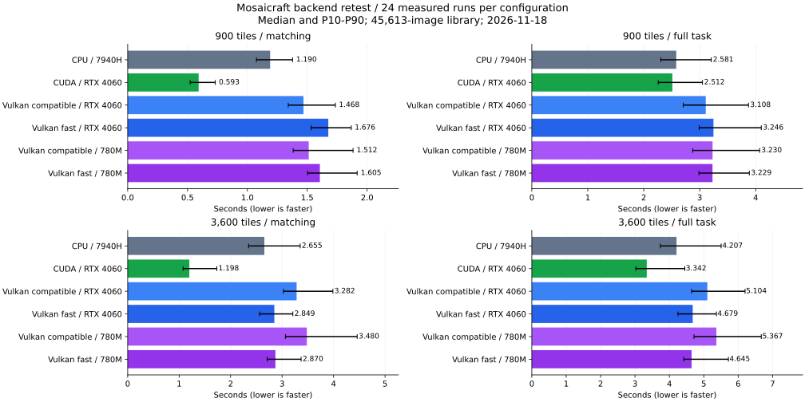

# CPU / CUDA / Vulkan 多轮复测（2026-11-18）

本次在 Ryzen 9 7940H、RTX 4060 Laptop 8 GiB、Radeon 780M 的同一台 Windows 机器上，比较同一个 Release 可执行文件的六种执行配置。测试仅覆盖固定目标的马赛克生成，不能外推建库、其他输入、超大输出或能耗。

后续扩大至 14,400 / 57,600 格并增加候选评分负载的结果见[重负载复测](backend-scale-20261118.md)。两篇报告的任务参数不同，应按各自场景解释后端排序。

## 结论

- **900 格：CPU 与 CUDA 的完整任务耗时接近。** 中位数为 2.581 / 2.512 秒；CUDA 同轮耗时比的 95% 区间为 0.940–1.007，包含 1，不能宣称有稳定的完整任务优势。
- **3,600 格：CUDA 明显更快。** 完整任务中位数由 CPU 的 4.207 秒降至 3.342 秒，减少 20.6%；同轮配对的耗时降低中位数为 22.0%，95% 区间约 18.7%–23.4%。匹配阶段中位数为 1.198 / 2.655 秒，约 2.22 倍吞吐。
- **两种规模下，CPU 均快于本次所有 Vulkan 配置。** 780M 和 RTX 4060 的 Vulkan 快速模式完整任务表现接近；大场景中快速模式比各自兼容模式好，但仍未胜过 CPU。
- CUDA 模板路径输出与 CPU 不同，因此这里比较的是当前后端的实际使用表现，不是相同输出的纯执行效率。全部 Vulkan 输出 PNG 与 CPU 逐字节一致。

后半段机器整体耗时下降，故保留全部样本和分块统计，并主要使用同一轮次内的配对比较；多轮测试降低了随机误差，不能消除系统状态变化。没有将本次数据直接用于修改自动后端策略。

## 方法

- 当前业务源码 `d8d383d6f`，采样工具提交 `d67313be7`；MSVC 19.51、OpenCV 4.12.0、CUDA 13.5.37，sm_89 + compute_89，Vulkan 启用。
- 45,613 张素材，图库特征规格 180×320；目标 `test_input_photos/target3.jpg`。工作图为 270×480 / 540×960，对应 900 / 3,600 格。
- 匹配和输出图块均为 9×16，输出 PNG 为 270×480 / 540×960；不是原生图块拼接的超大图性能。
- 固定 8 线程、候选数 150、Top-N 10、种子 42；关闭预览、分析和资源轮询。所有请求和参数均保留。
- 各配置、各场景先预热 3 次，再测 24 次；36 次预热 + 288 次正式运行。进程串行，后台桌面环境保持原状，接通交流电，Windows 平衡电源方案。
- 使用六配置 Williams 平衡顺序，每 6 轮平衡运行位置和前序配置，并随机置换标签和轮次；两种规模交替先后运行。
- 每次使用新进程，计时前从固定快照恢复整个私有数据库。素材只读复用，特征和 ANN 缓存在私有目录。正式采样 ANN 重建时间均为 0。
- 所有正式样本保留，不删除离群值。报告中位数、P10–P90；同轮与 CPU 配对，10,000 次 bootstrap 估计耗时比的 95% 区间。区间是单次连续会话的近似估计，仍可能受时间相关的系统波动影响。
- `totalMs` 为引擎完整生成计时；另记录 `processWallMs`，包含进程启动、析构和基准结果写出。数据恢复、结果校验在两者计时之外。
- 本次测的是预热后的文件/驱动缓存、新进程任务；未清空系统缓存，不是冷磁盘启动、常驻服务复用或功耗测试。

## 完整生成耗时

单位：秒。括号为 P10–P90，越低越快。

| 配置 | 900 格 | 3,600 格 |
|---|---:|---:|
| CPU · Ryzen 9 7940H | 2.581（2.306–3.207） | 4.207（3.738–5.506） |
| CUDA · RTX 4060 Laptop | 2.512（2.258–3.050） | 3.342（3.022–4.448） |
| Vulkan 兼容 · RTX 4060 Laptop | 3.108（2.706–3.872） | 5.104（4.646–6.201） |
| Vulkan 快速 · RTX 4060 Laptop | 3.246（2.990–4.101） | 4.679（4.248–5.368） |
| Vulkan 兼容 · Radeon 780M | 3.230（2.875–4.071） | 5.367（4.715–6.673） |
| Vulkan 快速 · Radeon 780M | 3.229（2.987–3.887） | 4.645（4.417–5.717） |

## 匹配阶段耗时

单位：秒。括号为 P10–P90。

| 配置 | 900 格 | 3,600 格 |
|---|---:|---:|
| CPU · Ryzen 9 7940H | 1.190（1.075–1.377） | 2.655（2.349–3.352） |
| CUDA · RTX 4060 Laptop | 0.593（0.522–0.732） | 1.198（1.076–1.733） |
| Vulkan 兼容 · RTX 4060 Laptop | 1.468（1.341–1.735） | 3.282（3.026–3.987） |
| Vulkan 快速 · RTX 4060 Laptop | 1.676（1.532–1.867） | 2.849（2.561–3.209） |
| Vulkan 兼容 · Radeon 780M | 1.512（1.382–1.883） | 3.480（3.064–4.458） |
| Vulkan 快速 · Radeon 780M | 1.605（1.503–1.917） | 2.870（2.710–3.370） |

## 相对 CPU 的完整任务耗时

同轮耗时比的中位数及 bootstrap 95% 区间；1.00 为 CPU，低于 1 更快。

| 配置 | 900 格 | 3,600 格 |
|---|---:|---:|
| CUDA · RTX 4060 Laptop | 0.971 [0.940, 1.007] | 0.780 [0.766, 0.813] |
| Vulkan 兼容 · RTX 4060 Laptop | 1.196 [1.143, 1.226] | 1.209 [1.179, 1.305] |
| Vulkan 快速 · RTX 4060 Laptop | 1.296 [1.234, 1.311] | 1.088 [1.056, 1.127] |
| Vulkan 兼容 · Radeon 780M | 1.220 [1.190, 1.270] | 1.238 [1.198, 1.292] |
| Vulkan 快速 · Radeon 780M | 1.242 [1.167, 1.300] | 1.098 [1.066, 1.141] |

## 结果校验与边界

每次任务均成功、无警告，实际设备和特征/评分后端符合请求。每种配置在同一场景的全部重复运行中，素材选择序列和输出 PNG 的 SHA-256 均保持一致。原图库数据库哈希在测试前后相同。

下表为各配置相对 CPU 的最终素材选择差异格数。CUDA 使用既有模板特征/评分路径；Vulkan compatible 使用 CPU 兼容评分，fast 使用 GPU FP32 距离。性能比较不等同于跨后端像素完全一致的保证。

| 配置 | 900 格差异数 | 3,600 格差异数 |
|---|---:|---:|
| CPU · Ryzen 9 7940H | 0 | 0 |
| CUDA · RTX 4060 Laptop | 651 | 2831 |
| Vulkan 兼容 · RTX 4060 Laptop | 0 | 0 |
| Vulkan 快速 · RTX 4060 Laptop | 0 | 0 |
| Vulkan 兼容 · Radeon 780M | 0 | 0 |
| Vulkan 快速 · Radeon 780M | 0 | 0 |

性能计时结束后，两种规模的质量检查并行执行，避免争用 CPU 干扰计时。使用现有 `mosaicraft_quality_benchmark` 的统一 CPU 五特征误差，不含使用历史和邻域惩罚；此指标不能代替主观画质判断。

| 场景 / 后端 | 平均误差 | P90 | P99 |
|---|---:|---:|---:|
| 900 格 CPU / 全部 Vulkan | 0.156506 | 0.217148 | 0.266453 |
| 900 格 CUDA | 0.156533 | 0.217610 | 0.262975 |
| 3,600 格 CPU / 全部 Vulkan | 0.156656 | 0.214924 | 0.260304 |
| 3,600 格 CUDA | 0.156849 | 0.215265 | 0.259790 |

CUDA 平均误差分别增加约 0.017% / 0.123%，本次固定样本的误差统计接近，但素材选择不同。所有质量检查的未匹配数为 0。未运行新增图库、其他目标或跨日的质量验收。

四个连续 6 轮区间的中位数保留在 JSON 的 `stability`，便于观察长时漂移；预热记录也保留，不混入正式结果。



## 数据与复现

- [汇总、全部计时样本、输入与程序哈希](../performance/backend-retest-20261118.json)
- 本机原始请求、每次日志、摘要、选择序列和输出：`build/backend-retest-20261118/runs/`。
- 本机清单：`build/backend-retest-20261118/manifest.json`。复测必须使用新的输出目录；按实际设备枚举修正清单中的设备 ID。

```powershell
python scripts/benchmark_backends.py build/backend-retest-20261118/manifest.json --benchmark build/windows-cuda-vulkan/Release/bin/mosaicraft_match_benchmark.exe --quality build/windows-cuda-vulkan/Release/bin/mosaicraft_quality_benchmark.exe --output build/backend-retest-20261118/repeat --rounds 24 --warmups 3
```
