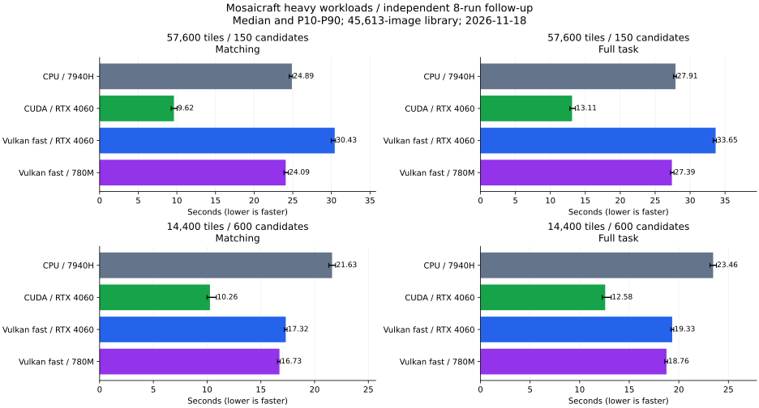

# CPU / CUDA / Vulkan 重负载复测（2026-11-18）

本次延续[上一轮复测](backend-retest-20261118.md)，扩大任务规模，比较固定输入下的 CPU、CUDA 和 Vulkan 快速模式。Vulkan 分别测试 RTX 4060 Laptop 与 Radeon 780M。

## 结论与适用范围

- 本文主表使用独立补测的 8 轮数据；前一批 12 轮单独保留。CUDA 在两个重负载场景均明显领先。Vulkan 的优势取决于任务组成，780M 也参与了完整比较。
- 14,400 格 / 600 候选可以明显区分 CUDA、Vulkan 与 CPU；57,600 格 / 150 候选保留默认候选量，用来避免只凭一个有利压力场景作判断。
- CUDA 出现一次相同输入、种子和后端下的选图变化。该样本及质量结果单列，不能以计时优势代替输出可重复性保证。本轮未修改生产算法。
- 这里只比较本机固定输入的生成耗时，没有测整机能量，不能据此比较每瓦效率。

## 测试设计

- 同一程序 SHA-256、同一 45,613 张图库、同一目标 target3.jpg；业务源码仍为 d8d383d6f。Ryzen 9 7940H、RTX 4060 Laptop 8 GiB、Radeon 780M，交流电、Windows 平衡方案。
- 固定 8 线程、种子 42、Top-N 10、特征规格 180×320；匹配/输出图块 9×16；关闭分析、预览和资源轮询。
- 先做 3 种规模 × 4 配置的单次探测，共 12 次。探测不计算置信区间，不参与正式统计，全部结果保留。
- 正式场景 A：57,600 格、每格 150 候选，输出 2160×3840 PNG，保持默认候选数，格数为上一轮 3,600 格的 16 倍。
- 正式场景 B：14,400 格、每格 600 候选，输出 1080×1920 PNG，增加候选评分负载。600 候选是压力场景参数，不是新的生产默认值。
- 两个场景的名义候选比较量均为 864 万次，但特征处理、排序与邻域操作的工作组成不同。
- 首批每场景、每配置预热 1 次、正式采样 12 次；发现系统负载变化后，独立补测各 1 次预热和 8 次正式运行。两批合计 160 次正式 + 16 次预热，另有 12 次规模探测和 3 次中断组诊断，共 191 次生成。每 4 轮平衡执行位置与前序后端，两场景交替先后。
- 复用上一轮私有图库和缓存，每次在计时外恢复完整数据库到独立工作文件。正式任务串行执行，质量检查和输出审计在计时结束后并行。没有并行运行会争用 CPU、内存或同一 GPU 的性能任务。
- 使用引擎 totalMs 和 matchingMs，另保留进程 processWallMs；PNG 编码包含在完整任务中。每次都是新进程，缓存已预热，不能当作冷磁盘或常驻服务基准。
- 不删除离群值。报告中位数、P10–P90、MAD/中位数；同轮耗时比 bootstrap 10,000 次估计 95% 区间。补测两个、首批三个连续 4 轮区间的配对中位数另行保留，用来观察漂移。

## 环境变化与中断处理

首批第 12 轮约 08:22（UTC+8）出现提速，用户确认当时关闭或停止了其他程序；具体程序和负载未记录。Windows 平衡电源方案未改变。大网格 NVIDIA Vulkan 从前 11 轮中位数 33.144 秒降至 20.764 秒，其他后端也加速。该轮完整保留，不混入补测统计。
补测重新预热后又回到较慢水平，因此不能把这次变化解释为持久的空闲环境加速，也不能把两批合成更窄的置信区间。本文报告系统状态的已知变化，没有宣称完全控制了温度、频率或后台负载。
补测第 4 轮大网格 CUDA 的选图哈希变化触发停止。该组已完成的 NVIDIA Vulkan、CPU 与异常 CUDA 三个输出均保留在 interrupted-sample；恢复时重跑这整组四后端，避免把长时间中断前后的单个任务配为同轮。生产程序、输入和参数不变。后续显式记录 CUDA 输出变化，其他校验仍保持严格。

## 全部规模探测

以下仅为单次结果，单位秒；用于选择后续负载，不用于统计排名。

| 场景 | CPU | CUDA | Vulkan RTX 4060 | Vulkan 780M |
|---|---:|---:|---:|---:|
| tiles14400-c150 | 7.056 | 4.379 | 7.340 | 7.773 |
| tiles57600-c150 | 28.208 | 12.988 | 32.807 | 26.691 |
| tiles14400-c600 | 23.868 | 12.704 | 18.729 | 18.466 |

## 完整生成耗时

独立补测每配置 8 次，单位秒，中位数（P10–P90）。

| 配置 | 57,600 格 / 150 候选 | 14,400 格 / 600 候选 |
|---|---:|---:|
| CPU · 7940H | 27.908（27.615–28.060） | 23.462（23.137–23.794） |
| CUDA · RTX 4060 | 13.106（12.777–13.597） | 12.576（12.268–13.187） |
| Vulkan 快速 · RTX 4060 | 33.652（33.299–33.768） | 19.334（19.200–19.492） |
| Vulkan 快速 · 780M | 27.393（27.167–27.697） | 18.757（18.580–18.873） |

## 匹配阶段耗时

独立补测每配置 8 次，单位秒，中位数（P10–P90）。

| 配置 | 57,600 格 / 150 候选 | 14,400 格 / 600 候选 |
|---|---:|---:|
| CPU · 7940H | 24.886（24.536–24.994） | 21.626（21.310–21.953） |
| CUDA · RTX 4060 | 9.620（9.260–10.041） | 10.264（9.986–10.865） |
| Vulkan 快速 · RTX 4060 | 30.433（29.986–30.546） | 17.317（17.178–17.443） |
| Vulkan 快速 · 780M | 24.089（23.866–24.443） | 16.732（16.544–16.812） |

## 分阶段线索

以下为补测的阶段耗时中位数（秒）。特征耗时含此阶段的处理开销；这些计时可能嵌套或重叠，不能相加得到总耗时。

| 配置 | 大网格特征处理 | 高候选特征处理 | 大网格 Vulkan 上传 | 高候选 Vulkan 上传 |
|---|---:|---:|---:|---:|
| CPU · 7940H | 7.794 | 1.961 | — | — |
| CUDA · RTX 4060 | 2.684 | 0.817 | — | — |
| Vulkan 快速 · RTX 4060 | 19.268 | 4.292 | 7.767 | 1.643 |
| Vulkan 快速 · 780M | 13.595 | 3.289 | 1.804 | 0.447 |

Vulkan 的 gpuUploadMs 测量写入映射缓冲区的 memcpy 及必要 flush，用主机时钟计时；它不是 PCIe 带宽测试。大网格中 RTX 4060 的该项明显高于 780M，与总耗时差方向一致，是本实现的数据搬运开销线索，不能据此宣称核显通用算力更强。CUDA 未提供相同口径的上传指标，表中留空。

## 配对比较

完整任务同轮耗时比；小于 1 表示分子更快，区间跨 1 时不宣称稳定优势。

| 比较 | 57,600 格 / 150 候选 | 14,400 格 / 600 候选 |
|---|---:|---:|
| cuda / cpu | 0.473 [0.458, 0.479] | 0.537 [0.520, 0.563] |
| vulkan-nvidia-fast / cpu | 1.201 [1.195, 1.221] | 0.822 [0.812, 0.835] |
| vulkan-amd-fast / cpu | 0.983 [0.977, 0.995] | 0.800 [0.794, 0.806] |
| cuda / vulkan-nvidia-fast | 0.390 [0.381, 0.402] | 0.649 [0.639, 0.688] |
| vulkan-amd-fast / vulkan-nvidia-fast | 0.818 [0.807, 0.827] | 0.971 [0.967, 0.976] |

## 偶然波动与长期漂移

MAD 为绝对偏差的中位数，除以耗时中位数衡量稳健相对波动。

| 配置 | 57,600 格 / 150 候选 | 14,400 格 / 600 候选 |
|---|---:|---:|
| CPU · 7940H | 0.57% | 0.87% |
| CUDA · RTX 4060 | 1.91% | 1.71% |
| Vulkan 快速 · RTX 4060 | 0.40% | 0.51% |
| Vulkan 快速 · 780M | 0.53% | 0.58% |

连续 4 轮区间的耗时中位数与配对比保留在 JSON 中。区间为本次会话内估计，系统负载、温度和频率变化仍可能产生相关波动；扩大工作量和重复采样不能保证完全消除误差。

## 首批 12 轮单列

以下为首批完整生成耗时中位数（秒），包含第 12 轮的快速样本；没有按速度剔除。完整波动范围与配对区间见 JSON 的 initial_run。

| 配置 | 57,600 格 / 150 候选 | 14,400 格 / 600 候选 |
|---|---:|---:|
| CPU · 7940H | 27.618 | 23.374 |
| CUDA · RTX 4060 | 12.853 | 12.490 |
| Vulkan 快速 · RTX 4060 | 33.108 | 19.195 |
| Vulkan 快速 · 780M | 26.521 | 18.412 |

## 输出与质量校验

全部运行均检查实际设备、评分路径、警告、匹配数和输出文件。CPU 与两种 Vulkan 配置保持选择序列及 PNG 哈希一致，并与 CPU 相同。CUDA 的输出变化单独统计。数据库每次恢复，原图库、准备快照及目标输入哈希保持不变。以下选图差异相对于 CPU，使用各配置首个样本。

| 配置 | 57,600 格选图差异数 | 14,400 格选图差异数 |
|---|---:|---:|
| CPU · 7940H | 0 | 0 |
| CUDA · RTX 4060 | 50324 | 11965 |
| Vulkan 快速 · RTX 4060 | 0 | 0 |
| Vulkan 快速 · 780M | 0 | 0 |

CUDA 使用既有模板路径，选图不保证与 CPU 相同，因此速度表示当前后端的实际表现。下表使用统一 CPU 五特征误差衡量输出，不含历史/邻域惩罚，不代替主观画质评价。

| 场景 | 配置 | 平均误差 | P90 | P99 |
|---|---|---:|---:|---:|
| tiles57600-c150 | CPU · 7940H | 0.161084 | 0.224521 | 0.284017 |
| tiles57600-c150 | CUDA · RTX 4060 | 0.161174 | 0.224597 | 0.283539 |
| tiles57600-c150 | Vulkan 快速 · RTX 4060 | 0.161084 | 0.224521 | 0.284017 |
| tiles57600-c150 | Vulkan 快速 · 780M | 0.161084 | 0.224521 | 0.284017 |
| tiles14400-c600 | CPU · 7940H | 0.156922 | 0.216880 | 0.266250 |
| tiles14400-c600 | CUDA · RTX 4060 | 0.156929 | 0.216688 | 0.266205 |
| tiles14400-c600 | Vulkan 快速 · RTX 4060 | 0.156922 | 0.216880 | 0.266250 |
| tiles14400-c600 | Vulkan 快速 · 780M | 0.156922 | 0.216880 | 0.266250 |

### CUDA 重复性异常

中断样本相对于同配置基线有 1,798 / 57,600 格（3.12%）选图变化，首处为零起始索引 55,094。输入、图库、种子、实际设备与评分路径未变；生成成功且无警告。程序执行耗时 13.093 秒，匹配 9.490 秒；因停止发生在写入样本之前，进程墙钟耗时未保留，JSON 明确记为 null。
该样本不参与平衡性能统计，三份中断组数据均完整保留。检查器中断属于输出重复性失败，不能称为所有校验通过。原因尚未最终定位；CUDA 特征归约存在浮点 atomicAdd，可作为后续定位线索，但本轮未证实因果。

| 场景 | 补测正式 CUDA 变化次数 / 8 | 额外诊断变化次数 | 包含诊断的 CUDA 选择序列种数 |
|---|---:|---:|---:|
| tiles57600-c150 | 0 / 8 | 1 | 2 |
| tiles14400-c600 | 0 / 8 | 0 | 1 |

不同选择序列都经过统一质量评估；误差接近不代表像素或选图可重复。

| CUDA 变化样本 | 平均误差 | 相对原 CUDA 平均误差变化 | 相对 CPU 平均误差变化 |
|---|---:|---:|---:|
| tiles57600-c150 / b3690f6b70ab | 0.161177167 | +0.0019% | +0.0576% |



## 原始数据与复现

- [全部探测与正式样本、程序/输入哈希、统计与质量结果](../performance/backend-scale-20261118.json)
- 本机请求、日志、选择序列和输出：`build/backend-scale-20261118/probe/`、`runs/`、`followup/`；中断组位于 `followup/interrupted-sample/`。
- 本机清单 `build/backend-scale-20261118/followup-manifest.json`；仓库报告保存 cases、variants、common_request 和输入/程序哈希，设备 ID 需按本机枚举核对。
- 私有缓存来自 `build/backend-retest-20261118/runs/`，复测需保证其 snapshot.db、images 和 features 完整。

```powershell
python scripts/benchmark_backends.py build/backend-scale-20261118/followup-manifest.json --benchmark build/windows-cuda-vulkan/Release/bin/mosaicraft_match_benchmark.exe --quality build/windows-cuda-vulkan/Release/bin/mosaicraft_quality_benchmark.exe --prepared-run build/backend-retest-20261118/runs --output build/backend-scale-20261118/repeat --rounds 8 --warmups 1 --record-variation cuda
```

`--record-variation cuda` 仅允许将 CUDA 重复输出差异作为显式诊断记录，不忽略执行失败、设备回退、未匹配或输入变化。省略它时默认遇到输出变化即停止。
